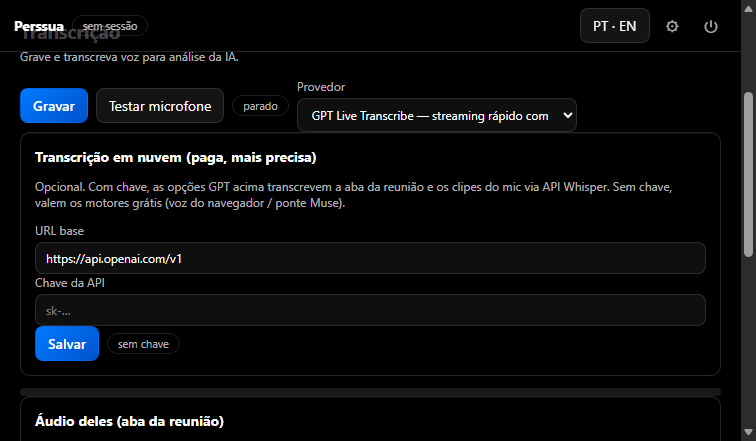
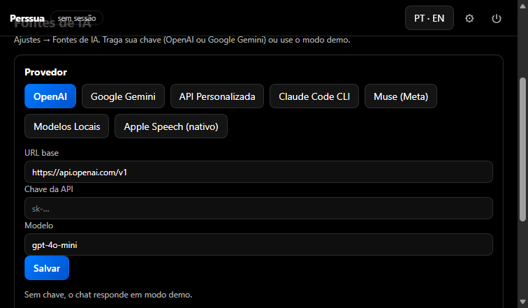

# Perssua Clone — Open Source AI Meeting Copilot

[](LICENSE)
[](README.md)
[](index.html)
[](js/i18n.js)
[](#contributing)

**Real-time AI meeting copilot in the browser: meeting-tab transcription, live
short answers on the other side's questions, interview practice mode, and free
local AI providers (Claude Code CLI, Muse). No login. No paywall. No trial.
Everything unlocked, free forever.**

Keywords: `ai-meeting-copilot` `meeting-assistant` `interview-assistant`
`real-time-transcription` `whisper` `live-answers` `claude-code` `open-source`

> Resumo em português no fim deste README ([versão PT-BR](#versão-pt-br)).



## Why this exists

Desktop AI meeting apps lock the useful parts behind accounts, trials and
credits. This is a clean-room, open-source rebuild as dependency-free
**HTML + CSS + JS** (+ a tiny zero-dependency Node bridge for local CLIs):

- Join a meeting, hear **both sides transcribed live** — your mic and the
  meeting tab, labeled `me:` / `them:` (`eu:` / `eles:` in PT).
- When the other side asks something (`Diga um exemplo de useEffect`, even
  without a `?`), a **Live Answer popup** shows a short reply you can say out
  loud — max 2 sentences, in the meeting language.
- Practice interviews: keep your private Q&A in a file **outside the repo**;
  the app never bundles personal data.
- Free providers first: answers from your installed **Claude Code CLI** /
  **Muse**, transcription from the **Muse bridge** — pay only if you want the
  faster OpenAI Whisper cloud option.

## Features

- **Quick Meeting mode** — mic check, speaker check, agent check and a
  transcription test, then join fast.
- **Their audio** — share the Meet/Teams/Zoom *browser tab* (audio ON);
  rolling windows transcribed continuously (10 s with cloud key, 20 s free).
  Auto-recovers from stalls, timeouts and background-tab mutes — with visible
  status instead of silent death.
- **Live Answer popup** — question detection in PT/EN (imperatives, `o que`,
  `como`, `me dê`, `exemplo de…`, name vocatives like `Deni, …`), never fired
  by your own mic.
- **Chat providers** — OpenAI, Gemini, Custom API (Ollama/LM Studio…),
  **Claude Code CLI**, **Muse**, auto-fallback to local CLIs, demo otherwise.
- **Transcription providers** — browser live speech (free), Muse bridge
  (free), OpenAI Whisper cloud (`gpt-4o-mini-transcribe` / `gpt-4o-transcribe`,
  needs your key).
- **112-member `window.electronAPI` parity** with the original desktop bridge;
  desktop-only calls are logged simulations.
- **4 product flavors** (Perssua / Cody / Notetaker light / Reuniao),
  sessions with full-text search, assistants library, screen capture analysis,
  integrations demos, legal docs, logs, onboarding, notch bubble.
- **PT-BR default, EN toggle** — every screen and dialog translated.



## Quickstart (2 minutes)

Requirements: **Node.js** (only for the bridge) + **Chrome or Edge**.

```powershell
git clone https://github.com/httpsDeni/Perssua-Clone-Open-Source.git
cd Perssua-Clone-Open-Source
node server.js
# open http://127.0.0.1:8080/
```

Static-only fallback (no local CLIs): just open `index.html` in Chrome/Edge.

First run: **Quick Meeting** → test mic, speaker, agent, transcription →
**Transcription** → *Share meeting tab audio* (pick the **Chrome Tab**, turn
**Share tab audio** ON) → keep this tab **visible side-by-side** (background
tabs get muted by the browser).

## Providers & keys

| Need | Provider | Key? | Speed |
|---|---|---|---|
| Meeting answers | Claude Code CLI / Muse (free, local) | No (uses each CLI's own login) | ~10 s |
| Meeting answers | OpenAI `gpt-4o-mini` | Yes, yours | ~2 s |
| Tab transcription | Muse bridge (free) | No | 20 s windows |
| Tab transcription | Whisper cloud `gpt-4o-mini-transcribe` | Yes, yours | 10 s windows |
| Mic live | Browser speech (free) | No | Instant |

Keys live **only in your browser's localStorage** — never in code, never
committed (see [.gitignore](.gitignore)). The repo contains **zero secrets**
and **zero personal data**. For interview practice, keep your Q&A in a
Markdown file **outside this folder** and paste from it; nothing you paste is
saved into the repo.

## Project structure (no build, no dependencies)

```text
index.html          # SPA shell + script order
server.js           # zero-dep Node bridge: static server + /api/bridge|ask|transcribe
css/styles.css      # dark glass theme + 4 flavors
js/store.js         # state, persistence, event bus, logs
js/i18n.js          # PT/EN exact-string dictionary + regexes
js/prompts.js       # assistant system prompts (kept in EN by design)
js/electronAPI.js   # 112-member desktop-bridge parity (logged stubs)
js/sessions.js      # sessions, messages, speaker-tagged transcript
js/speech.js        # live mic transcription (Web Speech, pt-BR default)
js/whisper.js       # paid Whisper cloud client (key only, never bundled)
js/wavrec.js        # mic/tab → 16-bit PCM wav encoder
js/meetaudio.js     # tab-audio capture, rolling windows, stall watchdog
js/autoanswer.js    # PT/EN question detection + Live Answer popup
js/chat.js          # chat orchestration: key API → local CLI → demo
js/capture.js       # screenshots + clipboard
js/views.js         # all screens
js/notch.js js/async.js js/shortcuts.js js/app.js
docs/screenshots/   # UI screenshots for this README
```

Bridge API: `GET /api/bridge` → `{claude, muse, ffmpeg}`,
`POST /api/ask {provider, prompt, model?}` → `{reply}`,
`POST /api/transcribe {audioBase64 (wav)}` → `{text}`
(wavs are normalized to 16 kHz mono — the format local CLI voices require).

## Browser support & honest limits

- **Chrome/Edge:** everything (live speech, tab audio, output routing).
- **Firefox:** chat, mic clips via bridge — no tab-audio capture, no live
  Web Speech (the app tells you on-screen).
- The web cannot do: global shortcuts, always-on-top invisible overlay,
  silent capture, local Whisper/LLM, real OAuth. These map to explicit
  share picks, the Node bridge and logged simulations.

## Roadmap (good first issues)

- AudioWorklet capture (fully background-proof tab audio)
- Word-level streaming answers in the popup
- Whisper `language` auto-detect per window
- One-click redaction of names before cloud calls
- Playwright smoke (render + no-console-error) in CI

## Contributing

PRs welcome. Keep it dependency-free and key-free: no `npm install`, no
secrets in code, no personal data in fixtures. Match the existing plain-JS
style, add PT + EN strings to `js/i18n.js`, and run the checks:

```powershell
node --check js/*.js server.js
```

## Make it discoverable (repo settings)

Suggested description: *Open-source AI meeting copilot: live transcription +
short answers in a popup. No login, no paywall.*

Suggested topics: `ai` `meeting-assistant` `interview-prep` `transcription`
`whisper` `realtime` `claude-code` `open-source` `javascript` `no-build`
`privacy` `productivity` `chrome` `chatbot`

## Versão PT-BR

**Copiloto de IA para reuniões, open source, no navegador.** Transcreve os
dois lados ao vivo (`eu:` / `eles:`), mostra **popup com resposta curta**
(máx. 2 frases, no idioma da reunião) quando o outro lado pergunta — mesmo
sem `?` — e roda com provedores grátis (CLIs Claude Code e Muse via ponte
local). Sem login, sem paywall, sem trial. Chaves ficam só no seu navegador.
 Firefox funciona parcial (sem áudio de aba). Rode com `node server.js` e
abra `http://127.0.0.1:8080/` no Chrome/Edge.

## License

[MIT](LICENSE) — free forever. If it helps you land the job, star it.
